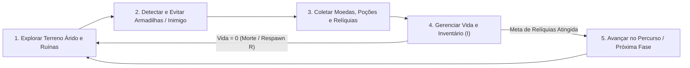

# Documento de Design de Jogo (GDD) — O Tesouro Perdido das Terras Secas

> **Subtítulo / Versão:** Versão Arqueólogo Metamorfo  
> **Título Alternativo:** *O Segredo das Areias*  
> **Autores:** Luan Victor das Chagas Soares, Carlos Nathan, Rafael de Souza do Carmo

---

## Ficha Técnica

| Atributo | Especificação |
| :--- | :--- |
| **Nome do Jogo** | O Tesouro Perdido das Terras Secas (*O Segredo das Areias*) |
| **Versão do Documento** | Versão Arqueólogo Metamorfo |
| **Gênero** | Aventura, Exploração Arqueológica, Furtividade e Ficção Científica Oculta (3D em terceira pessoa) |
| **Engine** | Unity `6000.3.23f1` |
| **Pipeline Gráfico** | Universal Render Pipeline (URP `17.3.0`) |
| **Principais Pacotes** | Cinemachine (`3.1.7`), AI Navigation (`2.0.16`), Input System (`1.20.0`), uGUI (`2.0.0`) |
| **Plataformas-Alvo** | Windows (`.exe` / `StandaloneWindows64`) e Android (`.apk`) |
| **Cena Oficial / Principal** | `Assets/_Project/Scenes/Cena_principal.unity` |
| **Cena de Desenvolvimento/Testes** | `Assets/_Project/Scenes/Cena_Coletaveis_Inventario.unity` |

---

## 1. Visão Geral e Nome do Jogo

- **Título Principal:** *O Tesouro Perdido das Terras Secas*
- **Título Alternativo:** *O Segredo das Areias*
- **Conceito Central:** Uma aventura em terceira pessoa que combina o imaginário clássico de expedições arqueológicas em regiões áridas com um mistério oculto de ficção científica. O jogador controla um alienígena metamorfo disfarçado de arqueólogo clássico em busca de artefatos valiosos e do núcleo de energia de uma nave ancestral soterrada nas dunas.

---

## 2. Tema, Cenário e Atmosfera

### Tema e Cenário
O jogo abandona os ambientes aquáticos tradicionais e transporta o jogador para uma vasta região árida, composta por:
- Desfiladeiros esculpidos pelo vento;
- Cânions profundos;
- Antigas catacumbas soterradas na terra seca.

O grande mistério da narrativa gira em torno de uma **civilização perdida** e dos destroços de uma **antiga nave espacial acidentada há séculos nas dunas** — conhecida e tratada pelos nativos e historiadores primitivos como um **"navio dos deuses"** caído na terra.

### Atmosfera
Mistério arqueológico clássico misturado com ficção científica oculta, marcado por poeira constante, calor sufocante, ruínas enigmáticas e perigos ancestrais.

---

## 3. Personagem Principal

O protagonista é um **alienígena metamorfo** infiltrado na Terra. Para camuflar sua verdadeira identidade extraterrestre e transitar livremente por sítios arqueológicos e acampamentos humanos, ele assumiu a forma física permanente de um **arqueólogo corajoso ao estilo clássico (estilo Indiana Jones)**, equipado com:
- Chapéu de aba larga;
- Jaqueta de couro desgastada;
- Ferramentas de escavação;
- Um chicote adaptado.

### Habilidade Distintiva
Utilizando sua capacidade de **mudança de forma molecular**, o protagonista pode mimetizar traços humanos para:
- Se disfarçar de rivais específicos;
- Enganar autoridades locais;
- Acessar zonas restritas e caminhos bloqueados sem levantar suspeitas.

---

## 4. Objetivo do Jogador

Explorar as profundezas das ruínas e os destroços da nave soterrada para:
1. Recuperar artefatos históricos de alto valor e relíquias raras;
2. Resgatar a tecnologia ultra-secreta escondida no coração da estrutura — o **núcleo de energia alienígena**;
3. Impedir que facções rivais ou caçadores de relíquias corruptos encontrem o núcleo antes e coloquem o segredo de sua espécie em risco.

---

## 5. Conceitos de Game Design: Framework MDA

Esta seção formaliza a relação entre regras do sistema (**Mecânica**), comportamento emergente durante a partida (**Dinâmica**) e experiência emocional entregue ao jogador (**Estética**).

### 5.1. Mecânica (*Mechanics*)
Conjunto de ações, sistemas e restrições implementados e planejados:
- **Locomoção e Câmera 3D:** Caminhada (`3.0 m/s`), corrida para frente (`6.0 m/s`), pulo (`1.2 m` de altura), rotação orientada à câmera Cinemachine e empurrão físico de objetos com `Rigidbody`.
- **Coleta e Inventário:** Coleta automática ao contato (moedas) ou interativa com `E` (relíquias e consumíveis), armazenamento em grade de `20` slots (`Inventario.cs`), uso de poções de cura (`Pocao_Vida`) e contagem de progresso rumo à meta de relíquias (`ObjetivoReliquias.cs`).
- **Combate Ambiental, Armadilhas e Inimigo Perseguidor:** Dano contínuo/pontual por armadilhas (`Armadilha.cs`, padrão `20` de dano), perseguição via `NavMeshAgent` (com fallback direto) em raio de `30 m`, carência inicial de `3.5 s`, preparo de golpe (`0.7 s` de *windup* a `2.2 m`) com golpe letal caso o jogador permaneça no alcance, além de estado de morte e renascimento (`R`).
- **Progressão e Expansão Futura:** Transição entre múltiplas fases pelo percurso e mecânicas de metamorfose, decifração de hieróglifos, escavação e veículos de época.

### 5.2. Dinâmica (*Dynamics*)
Comportamentos emergentes produzidos pela interação das mecânicas durante o jogo:
- **Gestão de Risco vs. Recompensa:** Para alcançar relíquias em áreas vigiadas, o jogador precisa decidir entre atrair e contornar o inimigo perseguidor ou avançar rapidamente usando a corrida.
- **Leitura de *Windup* e Esquiva:** Como o perseguidor sinaliza o ataque durante `0.7 s` antes do impacto letal e alterna entre caminhada (`<= 8 m`) e corrida (`> 8 m`), cria-se uma dinâmica de posicionamento e fuga reativa.
- **Gestão de Sobrevivência e Recursos:** Ao sofrer dano em armadilhas, o jogador abre o inventário (`I`) para decidir o melhor momento de consumir `Pocao_Vida` (impedindo desperdício com vida cheia).
- **Exploração Orientada por Feedback:** Contadores no HUD, avisos contextuais de coleta e notificações temporárias guiam a navegação pelo mapa sem interromper o ritmo.

### 5.3. Estética (*Aesthetics*)
Sensações principais que o protótipo busca despertar no jogador:
- **Descoberta:** Exploração de uma região árida hostil em busca de relíquias antigas e do segredo por trás do "navio dos deuses".
- **Desafio:** Superação de armadilhas mecânicas, rotas perigosas e da perseguição implacável da criatura guardiã.
- **Fantasia / Narrativa:** Assumir o papel de um arqueólogo clássico que, nos bastidores, é um infiltrado extraterrestre protegendo a tecnologia de sua espécie.
- **Tensão:** Pressão constante causada pela letalidade do perseguidor, pelo calor/cenário desértico e pela necessidade de cumprir a meta de relíquias sem sucumbir.

---

## 6. Regras do Protótipo

1. **Saúde Inicial e Dano:** O jogador inicia cada fase (e cada renascimento) com `100` pontos de vida (`VidaPersonagem.cs`). Armadilhas aplicam `20` de dano por padrão ao entrar no gatilho (podendo se autodestruir se `destruirAoTocar` estiver ativo).
2. **Coleta de Itens:**
   - **Moedas (`Moeda_Ouro`):** Coletadas automaticamente ao tocar no colisor *trigger* do objeto;
   - **Relíquias (`Reliquia_Inca`) e Consumíveis (`Pocao_Vida`):** Exigem proximidade e pressionamento da tecla `E`. Ao concluir a coleta total, o objeto é removido da cena.
3. **Uso do Inventário e Cura:** O inventário comporta até `20` slots (`I` abre/fecha; `Esc` fecha). Clicar em um slot com `Pocao_Vida` recupera `25` pontos de vida, consumindo `1` unidade — o uso é bloqueado se a vida já estiver em `100%` ou se o jogador estiver morto.
4. **Comportamento do Inimigo Perseguidor:**
   - Aguarda `3.5 s` no início da partida (e `2.5 s` de trégua após o respawn do jogador) antes de iniciar perseguição;
   - Detecta e persegue o jogador até `30 m` (`2.5 m/s` andando até `8 m`; `5.0 m/s` correndo acima de `8 m`);
   - Ao entrar na distância de ataque (`2.2 m`) ou colidir, inicia preparo de `0.7 s` executando animação (`Attack1`, `Attack2` ou `Attack3`). Se o jogador permanecer dentro de `3.2 m` ao fim do preparo, sofre dano letal instantâneo.
5. **Derrota e Renascimento (Respawn):** Ao atingir `0` de vida, os controles de locomoção são bloqueados, o HUD exibe a mensagem de eliminação e o jogador pode pressionar `R` para renascer com vida cheia.
6. **Condição de Vitória / Avanço de Fase:** Coletar a quantidade-alvo de relíquias definida em `ObjetivoReliquias.cs` (padrão `5` relíquias) e avançar no percurso rumo à próxima fase.

---

## 7. Loop de Gameplay (*Core Loop*)

O ciclo central de jogabilidade repete-se em escalas micro (encontros e coleta) e macro (progressão entre fases):

1. **Explorar:** Percorrer o cenário árido e as ruínas observando trilhas de moedas e pontos de interesse;
2. **Detectar e Evitar Ameaças:** Desviar de armadilhas de piso e gerenciar a distância do inimigo perseguidor aproveitando o tempo de preparo do golpe;
3. **Coletar:** Acumular moedas de ouro, recuperar poções de cura e resgatar relíquias antigas (`E`);
4. **Gerenciar Recursos:** Abrir o inventário (`I`) para restaurar vida quando ferido ou reiniciar o embate com `R` em caso de eliminação;
5. **Avançar:** Cumprir a meta de relíquias (`ObjetivoReliquias`) e progredir pelo percurso até a próxima fase ou objetivo final.

---

## 8. Obstáculos e Desafios (Visão Conceitual)

Os desafios do projeto completo dividem-se em três pilares principais:

### 8.1. Ambiente — Perigos Naturais
- Calor extremo e risco de desidratação;
- Tempestades de areia impiedosas;
- Cavernas subterrâneas altamente instáveis, com risco iminente de desmoronamento.

### 8.2. Ameaças — Fauna e Rivais
- Animais peçonhentos do deserto (como serpentes e escorpiões);
- Armadilhas ancestrais mecânicas espalhadas pelas ruínas;
- Mercenários humanos à espreita em busca dos mesmos tesouros.

### 8.3. Complexidade — Mecânica e Destroços
- Destroços metálicos emperrados por séculos de acúmulo de areia;
- Portas trancadas por enigmas lógicos;
- Necessidade constante de gerenciar o uso da metamorfose para evitar esgotamento energético ou exposições acidentais da forma alienígena.

---

## 9. Mecânicas e Ações do Jogador (*O Que o Jogador Poderá Fazer*)

De acordo com a especificação conceitual, a experiência completa contempla sete frentes de interação:
1. **Locomoção e Exploração:** Explorar o deserto implacável, cânions profundos e ruínas subterrâneas a pé ou utilizando veículos de época adaptados.
2. **Escavação e Travessia:** Escavar locais soterrados, escalar paredões rochosos e utilizar ferramentas de precisão arqueológica.
3. **Investigação e Enigmas:** Decifrar hieróglifos, inscrições antigas e pistas deixadas por civilizações extintas.
4. **Coleta e Progressão:** Coletar tesouros valiosos, relíquias raras e artefatos de valor inestimável.
5. **Metamorfose Estratégica:** Utilizar a habilidade de metamorfose para se disfarçar de rivais específicos ou abrir caminhos bloqueados.
6. **Furtividade e Agilidade:** Evitar armadilhas mortais e criaturas hostis através de furtividade e agilidade.
7. **Infiltração Final:** Infiltrar-se no núcleo dos destroços para recuperar a tecnologia secreta de sua raça.

---

## 10. Estado Atual do Protótipo vs. Roadmap

As listas abaixo documentam o que já está implementado na base técnica atual em `Assets/_Project/` em comparação ao restante previsto para o projeto e avaliação.

### 10.1. Implementado no Protótipo Unity
- **Movimentação em Terceira Pessoa (`ControleJogador.cs`):** Caminhada (`3.0`), corrida para frente com `Left Shift` (`6.0`), pulo com gravidade (`1.2`), rotação alinhada à câmera, amortecimento de parâmetros no `Animator` (`Locomocao` Blend Tree, `Corrida`, `Jump` no personagem Mixamo `Ch18_nonPBR`), som de passos, empurrão físico de objetos com `Rigidbody`, atalho `R` para renascimento e método auxiliar `ForcarAtivarMovimento()`.
- **Sistema de Vida, Morte e Respawn (`VidaPersonagem.cs`):** Controle de vida máxima (`100` por padrão), recebimento de dano, cura, barra de vida no HUD (`Image.fillAmount`), eventos estáticos `AoJogadorMorrer` / `AoJogadorRenascer`, desativação do controle ao morrer e método `Renascer()`.
- **Armadilhas (`Armadilha.cs`):** Gatilhos que aplicam dano ao jogador (padrão `20`) com opção de autodestruição ao contato (`destruirAoTocar`).
- **Inimigo Perseguidor (`InimigoPerseguidor.cs`):** Perseguição via `NavMeshAgent` (com fallback direcional caso não haja NavMesh assado na área) em raio de `30 m`, carência inicial de `3.5 s`, transição entre caminhada (`WalkF`) e corrida (`Run`), preparo de ataque (`0.7 s`) com animações (`Attack1`/`Attack2`/`Attack3`), golpe letal por proximidade ou colisão/trigger e trégua de `2.5 s` ao jogador renascer.
- **Inventário, Itens e Coletáveis (`Inventario.cs`, `ItemDados.cs`, `ItemColetavel.cs`):**
  - Inventário com capacidade padrão de `20` slots e suporte a itens empilháveis ou únicos (`ScriptableObject` via `ItemDados`);
  - Três tipos de item (`Moeda`, `Reliquia`, `Consumivel`), com os assets `Moeda_Ouro.asset`, `Pocao_Vida.asset` e `Reliquia_Inca.asset` em `Assets/_Project/Data/Itens/`;
  - Coleta automática (para moedas no modo `PorTipoDoItem`) ou interativa via tecla `E`, com animação de rotação/flutuação e ajuste automático de altura ao terreno.
- **HUD, UI do Inventário e Objetivo (`HUDInventario.cs`, `InventarioUI.cs`, `SlotUI.cs`, `ObjetivoReliquias.cs`):**
  - Contadores de moedas e progresso de relíquias em tempo real (meta padrão de `5` relíquias com evento `UnityEvent` ao concluir);
  - Aviso contextual de interação, aviso de eliminação com instrução de respawn (`[R]`), notificação temporária de coleta e painel de inventário abrindo/fechando com `I` (ou `Esc` para fechar) com exibição de nome, descrição e consumo de poções de vida.
- **Ferramenta de Editor (`GeradorColetaveisAutomatico.cs`):** Utilitários de menu (`Aventura Inca/1..6`) para gerar coletáveis/prefabs, montar HUD/inventário, elevar itens acima do solo, espalhar itens com inimigo, reposicionar inimigo a `20 m` e restaurar movimento do jogador.
- **Cenas:** `Cena_principal.unity` (cena oficial preservada para integração) e `Cena_Coletaveis_Inventario.unity` (cena isolada de desenvolvimento e testes).

### 10.2. Planejado (Próximas Entregas e Roadmap Conceitual)
- **Estrutura Multi-Cena e Menu Principal:** Criação de `Cena_MenuPrincipal.unity` com acesso a pelo menos `3` cenas jogáveis funcionais, gatilhos de transição de fase no percurso (`SceneManager.LoadScene`) e registro completo no `EditorBuildSettings.asset`.
- **Áudio de Contexto:** Atribuir `AudioClip` de coleta no campo `somColeta` dos prefabs `Coletavel_Moeda`, `Coletavel_Pocao` e `Coletavel_Reliquia` (além de efeitos opcionais de dano/ataque).
- **Padronização em Prefabs e Suporte Mobile:** Transformar Player/HUD/Câmera em Prefabs para uso uniforme em todas as cenas e adicionar controles *touch* na tela para gerar e validar os builds **Windows (`.exe`)** e **Android (`.apk`)**.
- **Expansão Conceitual do GDD:** Sistema de metamorfose molecular (energia/disfarces/exposição), veículos de época adaptados, escavação/escalada/chicote, decifração de hieróglifos, sobrevivência climática (calor, tempestades, desmoronamentos), fauna do deserto, mercenários humanos e fase final no núcleo da nave espacial.

---

## 11. Controles do Protótipo

| Entrada | Ação | Script Responsável |
| :--- | :--- | :--- |
| `W` / `A` / `S` / `D` ou Setas | Mover personagem | `ControleJogador.cs` |
| `Mouse` | Controlar direção da câmera | Câmera / Cinemachine |
| `Left Shift` (segurar + mover para frente) | Correr | `ControleJogador.cs` |
| `Espaço` | Pular | `ControleJogador.cs` |
| `E` | Coletar relíquias e consumíveis no alcance | `ItemColetavel.cs` |
| `I` | Abrir / fechar painel do inventário | `InventarioUI.cs` |
| `Esc` | Fechar painel do inventário (quando aberto) | `InventarioUI.cs` |
| `R` | Renascer com vida cheia quando eliminado | `ControleJogador.cs` / `VidaPersonagem.cs` |
| Clique no slot do inventário | Visualizar detalhes / usar consumível (`Pocao_Vida`) | `InventarioUI.cs` / `SlotUI.cs` |
